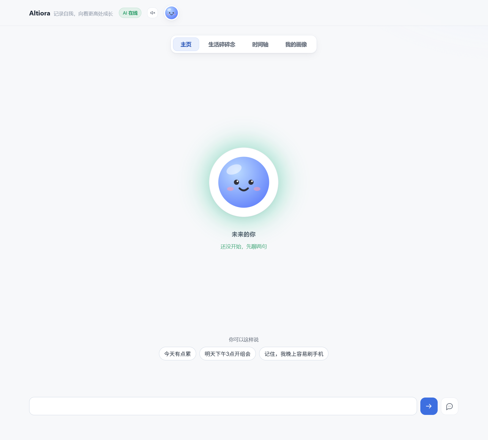
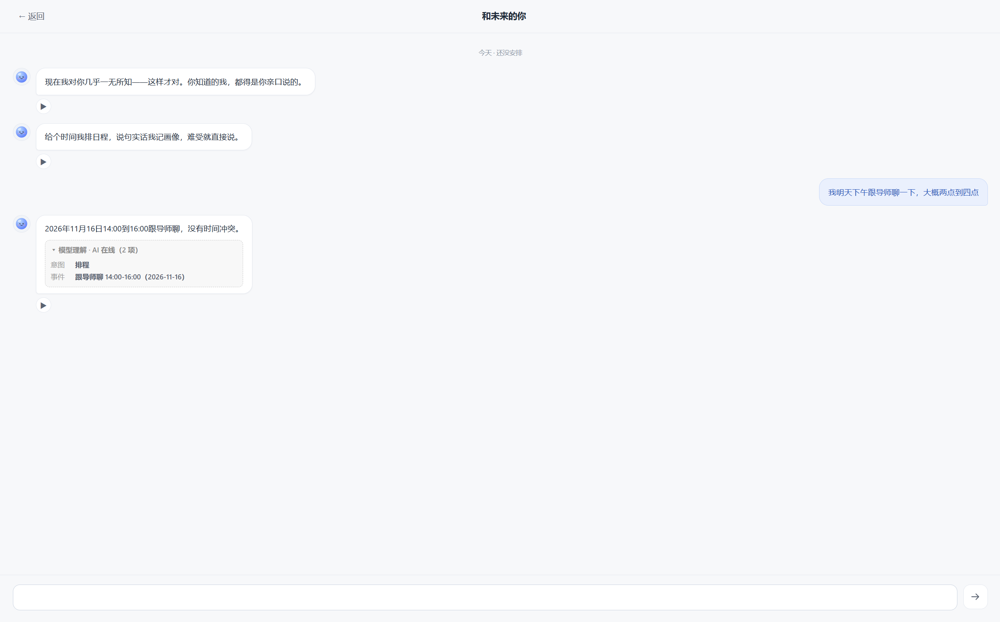
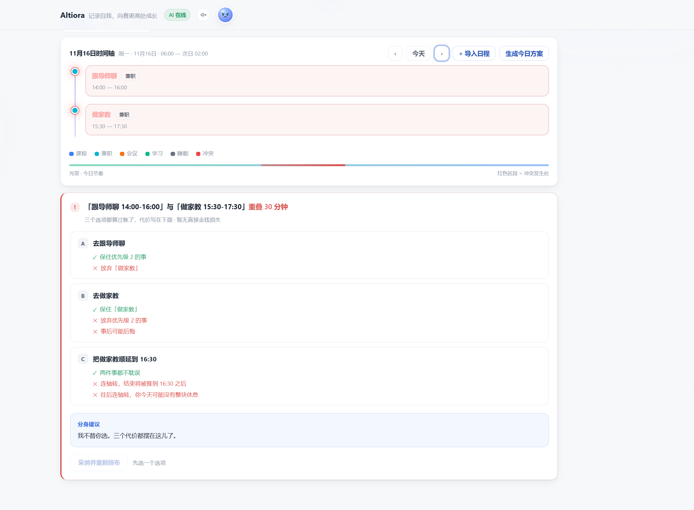
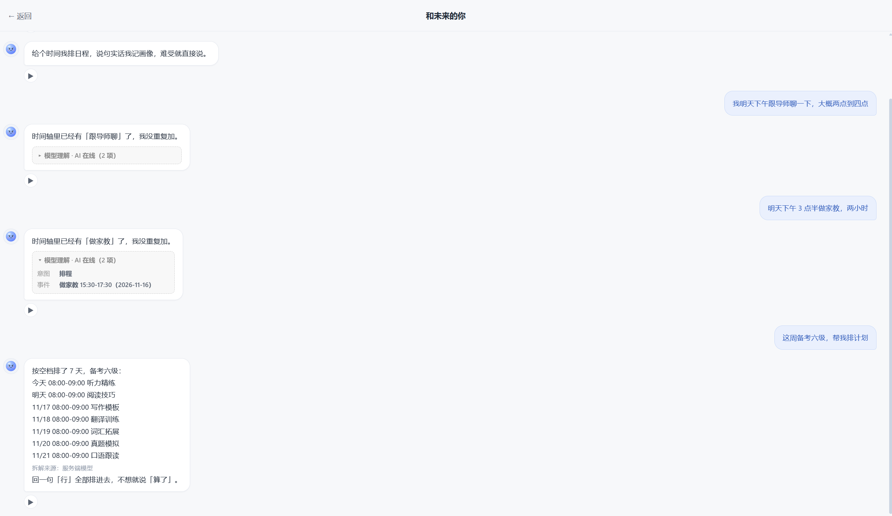
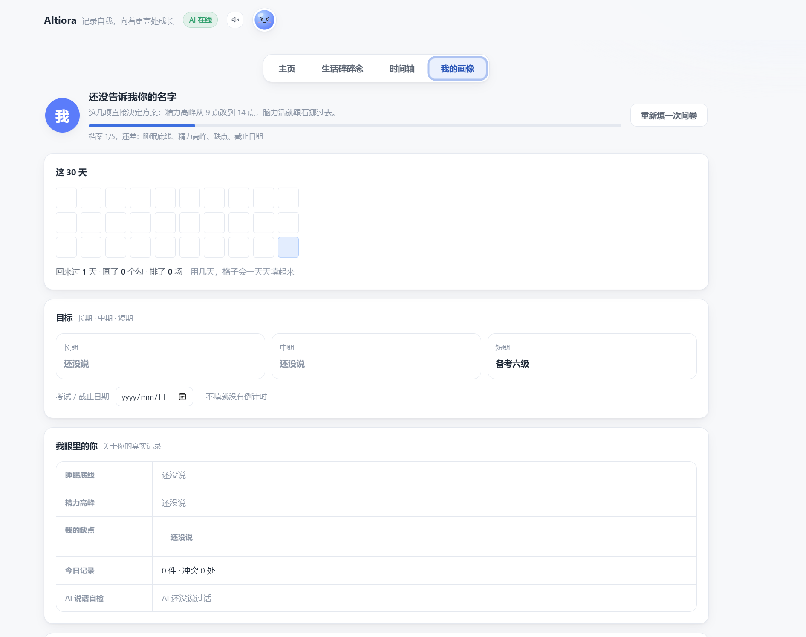
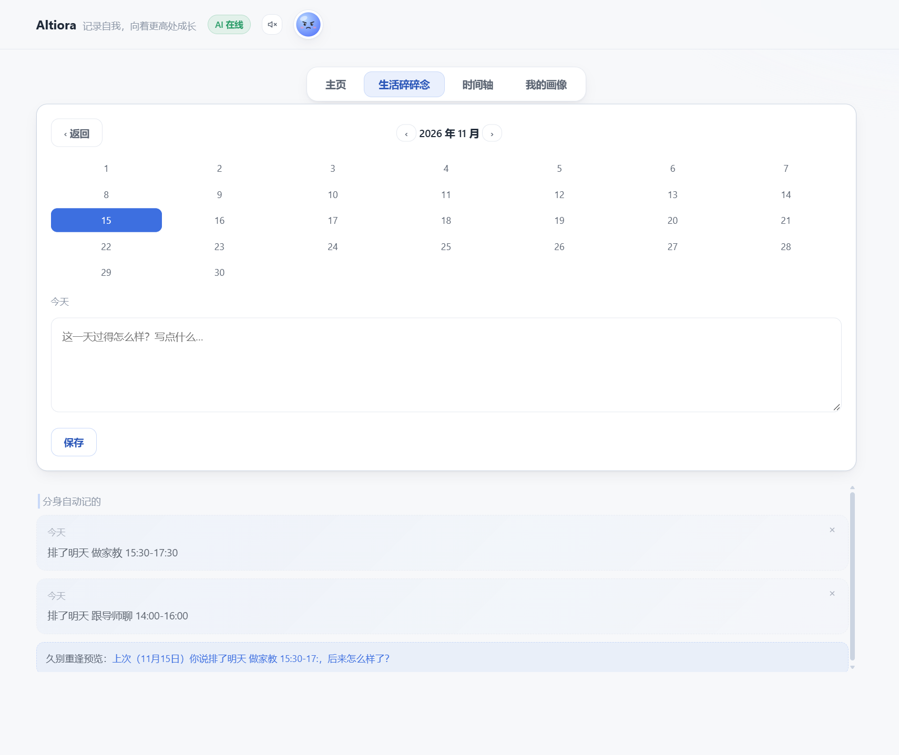

# Altiora.luck 作品介绍文档

## （1）项目详情及使用方式

**项目名称**：Altiora.luck —— "更好的自己"数字孪生分身 + 代价测算引擎

**项目定位**：一款个人效能管理工具。与传统日历 App 只标红冲突不同，Altiora 会把每个选择的代价（金钱、时间、后悔值）算清楚，摆成 A/B/C 三个选项让用户自己选，绝不替用户做决定。

**使用方式**：
- 在线体验：`http://82.157.162.252:8000/`（打开即 AI 在线，无需配置）
- 90 秒上手：① 说「我明天下午跟导师聊一下，大概两点到四点」→ ② 看理解卡列出抽取字段 → ③ 再发「明天下午 3 点半做家教，两小时」，切到时间轴看 A/B/C 代价卡
- 双击 `Altiora-未来的我.html` 即可运行，无需安装、无需联网（有 API Key 可启用 LLM 润色，无 Key 时理解与话术降级为离线引擎，功能可用）
- 「我的画像」页可填写或重填 6 步问卷（软肋、睡眠、精力高峰、目标、称呼、颜色），改完即时影响方案
- 在输入框用自然语言添加日程，如"明天 11 点到 1 点家教，时薪 80"
- 冲突时自动弹出 A/B/C 代价卡片，用户自行选择
- 支持"记住…"指令写入行为规矩、情绪倾诉只接一句不灌鸡汤、每次对话自动写日记

---

## （2）项目亮点

1. **AI 负责理解（把口语翻译成字段、把目标拆成每天练什么），计算永不出模型**：所有冲突检测、代价账单、排程均由本地确定性 JS 计算，同一输入永远同一输出。
2. **意图控制三层锁**：System Prompt 写死边界 + `_BANNED` 正则过滤客服腔 + `reply=None` 强制兜底，模型越不了界。
3. **代价可视化**：冲突不喊"你应该去"，而是摆 A/B/C 三个选项各自的代价（亏多少钱、破不睡底线、事后后悔），把选择权还给用户。
4. **档案驱动排程**：精力高峰、睡眠底线、软肋等档案参数直接影响今日方案，改一个参数方案肉眼可见地变，档案不是摆设。
5. **三层记忆**：长期记忆（画像）+ 聊天记忆（3 轮滚动）+ 日记（自动摘要），隔 3 天回来会问"上次你说的事后来怎么样了"。

### 2.1 功能地图

| 页签 / 模块 | 能做什么 | 一句话证据 |
|---|---|---|
| 主页对话 | 说一句就排；冲突出 A/B/C 代价卡 | 说「明天下午 3 点半做家教，两小时」，时间轴出现重叠 30 分钟 |
| 时间轴 | 日 / 周 / 月三视图，课表导入，事件增删改 | 改一个精力高峰，方案里的脑力活位置会变 |
| 生活碎碎念 | 日记 / 随手记 / 我的生活圈三类；每轮对话自动记一条 | 聊完两句，日记里多出一条摘要 |
| 我的画像 | 目标三级与截止日、软肋、睡眠底线、精力高峰；问卷可重填 | 说「记住我晚上爱刷手机」，写进画像软肋 |

- **今日方案**：只展示不改，说了才动你的表
- **主动关心**：目标倒计时、没打勾的提醒、空档提示

---

## （3）AI 测试技术落地使用情况概述

### 3.1 产品中的 AI 能力

**AI 在本项目中的角色是"翻译官"，不是"决策者"**：

- **自然语言理解**：用户输入"明天 11 点到 1 点家教，时薪 80"，LLM 提取为 `{intent:"schedule", event:{name:"家教", start:"11:00", end:"13:00", wage:80}}`，冲突和代价由本地代码计算。
- **结果表达**：本地计算器算出冲突后，LLM 把确定结果说成一句人话，且只允许引用已有数字，编造数字整句作废。
- **目标拆解**：把「备考六级」这类目标拆成每天练什么，条数由请求参数决定（1–7 条），只出清单，不排时间、不算代价。
- **BYOK 架构**：用户自带 API Key，Key 只存浏览器 localStorage，服务端不落盘、不写日志；自填 URL 只允许公网 https，带 DNS 重绑定防护。
- **确定性兜底**：无 Key 或 LLM 调用失败时，理解与话术回退离线引擎，功能可用。

### 3.2 开发中的 AI 测试落地

开发过程中使用 Trae 做 Bug 排查、代码审查与回归用例生成。下面三条是**AI 判断错了、靠证据纠正**的真实记录，每条都写清：什么输入、AI 给的判断、人怎么纠正、用什么断言证明修好。

**链 A·错误宣布功能丢失**

- **输入**：「时间轴和课表是不是被改没了？」
- **AI 的判断**：搜索 `renderMonth` 未命中，回答「月视图功能已经丢失」。
- **人的纠正**：不接受该结论，要求按代码里真实存在的函数名重新核查，并上传手机缓存的页面作为反证。
- **断言与结果**：按 `renderTLMonth` / `setTLView` 逐处检索，函数定义与调用都在，页面正常渲染，判定功能完好并撤回结论。
- **留下的规则**：搜不到不等于不存在，核查功能一律以代码里的真实标识符为准。

**链 B·改完不生效**

- **输入**：改完页面、本地测通并推送，用户在手机上打开仍是旧版。
- **AI 的判断**：本地已通过，认为已生效。
- **人的纠正**：要求不看编辑器，改看服务端实际返回的字节。
- **断言与结果**：`curl` 取服务端返回的 HTML 与本地文件做 `md5sum` 比对，两值不同；定位到服务端实际返回的是 `Altiora-未来的我.html`，改的不是同一份文件。同步后两端 md5 一致。
- **留下的规则**：验证看服务端返回的字节；`自检.py` 现有「单一成品」一项守卫，全仓只允许 1 份成品 HTML。

**链 C·buildPlan 恒返回空档**

- **输入**：「六级每天两个半小时，帮我排到考前的计划，晚上 8 点开始。」
- **AI 的判断**：多天排程 `buildPlan` 回「没有够 2.5 小时的空当」。
- **人的纠正**：不再反复改文案，要求同一份数据分别调单时段接口 `proposeSlot(150)` 与 `buildPlan`，把各自候选窗口打出来对比。
- **断言与结果**：`proposeSlot(150)` 给出 `08:00-10:30`，`buildPlan` 为空，两条路径结论相反；差异落在「从 20:00 起搜索」这一参数与按天重置上。统一窗口口径后，同一输入两路径结论一致，逐天 `items` 非空。
- **留下的规则**：两个函数对同一份数据给出不同结论时，先查参数不一致；此后验证改用「同一输入跑两条路径对拍」。

回归项均为实际执行过的检查：`python3 自检.py` 的 8 项（Python 版本、依赖、语音模型、前端控件、内联脚本语法与 Key 泄漏、单一成品、服务启动、识别接口），加上上述三条链各自的判据。

---

## （4）项目中涉及的关键技术

| 技术 | 用途 |
|---|---|
| 单文件 HTML + 原生 JS | 前端全部逻辑，零构建、零依赖 |
| localStorage / IndexedDB | 本地数据持久化，隐私不出浏览器 |
| 确定性排程算法 | 冲突检测、代价计算、精力高峰调度，纯本地 |
| FastAPI（Python 3.10+） | 可选后端，LLM 翻译网关 |
| LLM 意图控制 | System Prompt + 正则黑名单 + 运行时校验三层锁 |
| DNS 重绑定防护 | `_safe_base` 两层校验（字符串前缀 + DNS 解析查私网 IP） |
| 系统 TTS | 免费离线语音朗读 |

---

## （5）项目相关的图片/照片

以下截图均取自线上体验地址 <http://82.157.162.252:8000/>，右上角「AI 在线」表示服务端模型已接入。

**图 1 · 首页**：打开即用，不用配 Key；首屏给三句示例，减少评委的输入成本。

{width=5.6in}

**图 2 · 模型理解**：一句话抽成意图、事件、时间，摊开给用户核对，模型理解得对不对看得见。

{width=5.6in}

**图 3 · 冲突与代价**：两件事重叠 30 分钟，A/B/C 三个选项各自要付什么代价写在卡里，程序不替用户选。

{width=5.6in}

**图 4 · 今日方案**：目标由模型拆成每天练什么，底部标注「拆解来源：服务端模型」；时间仍由本地计算。

{width=5.6in}

**图 5 · 我的画像**：目标、软肋、睡眠底线、精力高峰都在这页，缺哪项直接写出来（档案 1/5）。

{width=5.6in}

**图 6 · 生活碎碎念**：日记由分身自动记录，隔几天回来会主动回访上次那件事。

{width=5.6in}

---

## （6）项目之前是否发表过或获奖

本项目为首次参加传智杯 Vibe Coding 挑战赛 B 组·赛道 8 个人效能与数字孪生具身仿真，未在其他场合发表或获奖。

---

## （7）若项目是在其他项目基础上优化，请说明优化部分

本项目为独立开发，非基于已有项目优化。开发过程中参考了日历类应用的冲突标红机制，但核心设计（代价 A/B/C 选项、AI 只翻译不决策、档案驱动排程）均为原创。
